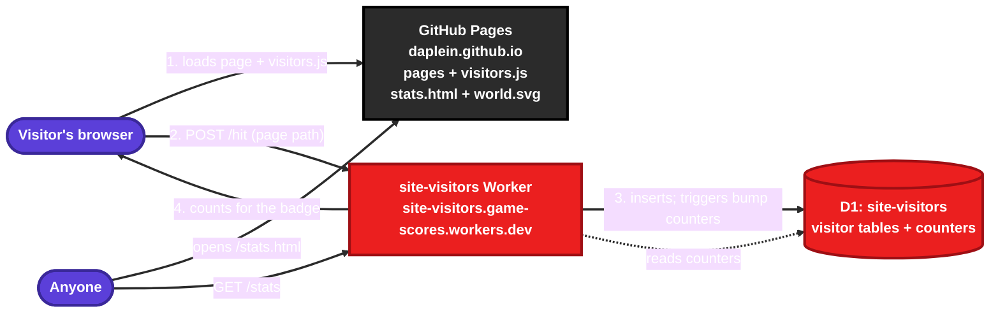

# site-visitors: spec

A unique-visitor counter for [daplein.github.io](https://daplein.github.io), with a public stats page that shows how many people visit and where they come from.

Status: **v1 live** since 27 Nov 2026.

## Goals

- A small badge on every page: site-wide visitor count plus this page's count, linking to the stats page.
- A public stats page anyone can open: a world map of visitors, totals, unique visitors per month, countries, mobile vs desktop, cities, top pages.
- Count **unique** visitors, so reloading or coming back the same month doesn't count again.
- Keep the data to location and page. Never store a raw IP address.

## Non-goals (v1)

- Referrers, browsers, screen sizes, time on page. Location and mobile-or-desktop are the only details kept.
- Backfilling history. Counting starts at zero on deploy.

## Architecture



It follows the same setup as `game-scores`: one Cloudflare Worker and one D1 database, deployed with Wrangler, on the same Cloudflare account. It runs as a separate Worker so the two can't break each other.

The site has no custom domain, so the Worker lives on the account's workers.dev subdomain: `https://site-visitors.game-scores.workers.dev`. The Worker is only an API. The badge script, stats page and map are plain static files on GitHub Pages.

## Definitions

| Term | Meaning |
|---|---|
| **Visitor** | `sha256(salt + IP + User-Agent)`, as hex. Adding the User-Agent separates people who share one IP (an office, home Wi-Fi, a mobile carrier). `salt` is a Wrangler secret (`VISITOR_SALT`) and never appears in the repo. |
| **Month** | The calendar month in UTC, `YYYY-MM`. |
| **Unique per month** | A visitor counts once per month for the site, and once per month for each page. |
| **Total visitors** | Distinct visitors across all time, shown as the headline number. |
| **Page** | `location.pathname`, normalized: `/index.html` becomes `/`, and `/x/index.html` becomes `/x/`. Query string and hash are dropped. |

Known imperfections (fine for a personal site):
- When someone's IP changes (mobile data, home router restart) or their browser updates, their visitor hash changes too, so a returning visitor can sometimes count again.
- Two people with the same IP *and* the same browser version count as one.

## What gets stored

See [migrations/0001_visitors.sql](migrations/0001_visitors.sql). Each table's primary key is what "unique" means for it:

| Table | Primary key | Holds |
|---|---|---|
| `visitors` | visitor | all-time unique visitors, with country/region/city where first seen and `device` |
| `site_months` | month, visitor | unique visitors per month, with `device`, plus `ip` = `sha256(salt + IP)` for the per-IP cap |
| `page_visitors` | page, visitor | unique visitors per page, all time |
| `page_months` | page, month, visitor | unique visitors per page, per month |
| `counters` | kind, key, period | running totals: `site`, `page`, `country`, `city`, `device` × `all` or `YYYY-MM` |

A hit is one batch of `INSERT … ON CONFLICT DO NOTHING`s. SQLite triggers bump `counters` only when a row is really new, so a repeat visit changes nothing and nothing can double count. Reading counts (the badge, `/stats`) only touches `counters`, which stays small (a few hundred rows). That keeps D1 reads far inside the free tier however big the visitor tables get.

Location comes from Cloudflare's `request.cf`, so there's no reverse IP lookup and no third-party service. A visitor with no country is filed under `XX`.

**Device** (added in `0002_device.sql`) is `mobile` or `desktop`, worked out from the User-Agent when the visit is counted (`deviceType` in `src/lib.ts`). Phones and tablets are mobile. iPads that ask for the desktop site look like a Mac and count as desktop. Since the browser is part of the visitor hash, one person on a phone and a laptop is two visitors, one of each.

Not stored: raw IP, User-Agent, cookies, referrer, timestamps of repeat visits. The Worker never logs the IP.

## Abuse guards

The counts are public, so a few cheap guards:

- **Origin:** `POST /hit` only accepts the site's origin (`ALLOWED_ORIGINS`).
- **Bots:** a missing User-Agent or one matching `bot|crawl|spider|slurp|headless|preview|lighthouse|monitor|curl|wget|python|…` isn't counted. Most bots don't run JavaScript anyway.
- **Per-IP cap:** one IP can add at most **20** distinct visitors a month, so cycling User-Agents from one machine can't inflate the count. Visitors already counted from that IP keep working.
- **Real pages only:** a page is counted only if it's already known, or if a `HEAD` request to `SITE_ORIGIN + page` succeeds. Nobody can put made-up paths on the public pages list.
- **Strict paths:** paths must match `^/[A-Za-z0-9/._~%-]*$`, at most 200 characters, with no `//` and no `..`.

## API

All responses are JSON. `POST /hit` and its CORS preflight allow only `ALLOWED_ORIGINS`. `GET /count` and `GET /stats` are public (`Access-Control-Allow-Origin: *`).

### `POST /hit`

Body: `{ "page": "/pickleball-training.html" }`. Counts this visitor (unless a guard above says no) and returns the badge numbers:

```json
{ "site": { "total": 1234, "month": 87 }, "page": { "total": 56, "month": 9 }, "counted": true }
```

### `GET /count?page=/pickleball-training.html`

Same response, read-only (`"counted": false`). Used by browsers that opted out.

### `GET /stats`

Everything the stats page needs, in one call (`Cache-Control: max-age=60`):

```json
{
  "total": 1234,
  "month": 87,
  "months":    [{ "month": "2026-11", "visitors": 87 }],
  "countries": [{ "country": "IE", "visitors": 610, "month": 41 }],
  "cities":    [{ "city": "Dublin", "region": "Leinster", "country": "IE", "visitors": 140 }],
  "pages":     [{ "page": "/", "visitors": 980, "month": 60 }],
  "sections":  [{ "section": "/wing-alert/", "visitors": 88, "month": 20,
                  "pages": [{ "page": "/wing-alert/", "visitors": 70, "month": 14 }],
                  "days":  { "visitors": 70, "month": 15, "pages": [{ "page": "/wing-alert/days/2026-11-28.html", "visitors": 30, "month": 6 }] } }],
  "devices":   [{ "device": "mobile", "visitors": 790, "month": 61 }, { "device": "desktop", "visitors": 444, "month": 26 }]
}
```

- `months`: the last 12 months, oldest first, site-wide unique visitors per month, including months with zero visitors.
- `devices`: always `mobile` then `desktop`, zeros included.
- `countries`, `cities`, `pages`: all-time distinct visitors, sorted descending. `month` is this month's count, which feeds the map's toggle.
- `sections`: `pages` grouped so a part of the site with many pages takes one row. A section is a page's top folder (`/wing-alert/days/2026-11-28.html` → `/wing-alert/`), or the page itself at the root (`/`, `/stats.html`). Pages named after a date (`…/2026-11-28.html` or `…/2026-11-28/`) fold into `days` when a section has two or more; otherwise `days` is `null`. A section's or `days`' count is **distinct** visitors across its pages, not the sum (someone who reads five daily forecasts is one Wing Alert visitor), counted from `page_visitors` / `page_months`. Groups of one page reuse that page's counters, so only multi-page groups cost a query.
- **City privacy:** only cities with **3 or more** visitors are listed, so "1 visitor from a small village" can't point at a person. Countries are always listed.

## The badge (`site/visitors.js`)

One line added to every page of the site, just before `</body>`:

```html
<script src="/visitors.js" defer></script>
```

The script:
1. Works out the page path.
2. If `localStorage["site-visitors:ignore"]` is set, calls `GET /count`. Otherwise it calls `POST /hit`.
3. Adds a small line at the end of `<main>` (or `<body>`): **👋 1,234 visitors · 56 on this page · [where from?](/stats.html)**. It fills `<div id="site-visitors">` instead if the page has one.
4. `data-badge="off"` on the script tag counts the visit without showing anything. Use it on full-screen games.
5. Does nothing visible if the request fails. The page never breaks because of the counter.
6. Talks to `http://localhost:8787` when the page is served from localhost, so local testing never touches the real counter.

## The stats page (`site/stats.html`)

It uses the same look as `index.html` (cream background, white cards, red accent) and needs no libraries.

Sections, top to bottom:
1. **Headline:** total visitors, plus this month's count.
2. **World map**, which shows **where** and **how many** at a glance:
   - **Bubbles for volume:** a red circle on each country that has visitors, with its *area* proportional to the visitor count. Bubbles read better than shading for volume, and small countries (Malta, Singapore) still get a visible dot.
   - The number is printed inside big bubbles. Labels sit in a layer above all bubbles, and a label is skipped if it would overlap a bigger one, which matters in crowded Europe.
   - **Light shading** on every country that has had a visitor.
   - Hovering or tapping a bubble or country shows "🇮🇪 Ireland: 610 visitors (54%)".
   - An **All time / This month** toggle switches the bubbles between the two numbers.
   - A **World / Europe** toggle zooms smoothly into Europe, where bubbles crowd. Bubbles and labels keep their on-screen size while the map grows, so neighbours (Ireland and the UK) spread apart. The Europe frame is computed by `build-map.mjs` (`data-europe` on the `<svg>`) with the world map's aspect ratio, so the page doesn't jump.
3. **Countries:** flag emoji (made from the ISO code), name (from `Intl.DisplayNames`), visitor count and a bar. Shows the top 10 with a "Show all" button.
4. **Mobile or desktop:** two split bars (all time and this month), red for mobile and charcoal for desktop, with percentages and counts.
5. **Visitors per month:** a bar chart of the last 12 months, drawn in plain SVG, with the current month in red.
6. **Cities** (3+ visitors) and **Pages**, side by side. Pages lists sections: a single-page section is a plain link; a bigger one shows "wing-alert · 14 pages" and opens to its pages, with dated pages folded into one "12 days" row (newest first) that opens in turn. Top 8 sections, then "Show all".
7. **How this works:** IPs are hashed and never stored, only country, region and city are kept, there are no cookies, and the code is open.

The page counts its own visit first, then loads `/stats`, so a visitor sees themselves included.

### How the map is made

`site/world.svg` has one `<path data-cc="IE">` per country (ISO alpha-2, matching `request.cf.country`), plus a hidden `<g class="anchors">` with one `<circle data-cc cx cy>` per country marking where its bubble goes. Shapes come from Natural Earth 1:110m (174 countries, small file). Anchors come from 1:50m, which also has tiny countries, so all 235 get a bubble position. An anchor is the centroid of the country's largest landmass, so France's sits in France and not between Paris and French Guiana.

`npm run map` (`scripts/build-map.mjs`) generates it with `d3-geo` (Equal Earth projection), `topojson-client`, `world-atlas` and `i18n-iso-countries`, all dev dependencies. Antarctica is left out. The output is about 120 KB, or 42 KB gzipped. Natural Earth is public domain.

## Not counting yourself

Opening `https://daplein.github.io/stats.html?me` sets `localStorage["site-visitors:ignore"] = "1"` in that browser and shows a "This browser isn't counted" note with a link to undo it (`?me=off`). Do it once on each device and browser.

## Repos and layout

**`daplein/site-visitors`** (this repo, public):

```
SPEC.md, README.md
wrangler.jsonc               Worker + D1 binding + vars
migrations/0001_visitors.sql tables + counting triggers
src/index.ts                 routes: /hit, /count, /stats
src/lib.ts                   pure helpers (page paths, bots, months)
test/                        Vitest + @cloudflare/vitest-plugin, runs in workerd
site/visitors.js             the badge          ┐ copied into
site/stats.html              the stats page     │ daplein.github.io
site/world.svg               the map (generated)┘
scripts/build-map.mjs        Natural Earth → site/world.svg
scripts/seed-demo.mjs        fake counters for trying stats.html locally
```

**`daplein/daplein.github.io`**: gets `visitors.js`, `stats.html` and `world.svg` at the root, plus the script tag on every page.

The salt is set with `wrangler secret put VISITOR_SALT`, so the repo holds no secrets and can stay open source. The D1 `database_id` in `wrangler.jsonc` isn't a secret.

## Deploying

From this machine, the same way as `game-scores`. A GitHub Action with a Cloudflare API token as a repository secret could do it on push later; secrets stay hidden in a public repo.

1. `npx wrangler login` (opens the browser).
2. `npx wrangler d1 create site-visitors`, and paste the id into `wrangler.jsonc`.
3. `npm run db:migrate`
4. `npx wrangler secret put VISITOR_SALT` (a long random string, e.g. `openssl rand -hex 32`).
5. `npm run deploy`
6. `npm run publish-site` copies `site/*` into `daplein.github.io`. Add the script tag to every page (`data-badge="off"` on full-screen games), then push. See README for which pages are generated by other tools.
7. Visit `stats.html?me` from your own devices.

## Ideas for v2

- Pinch-zoom and pan on phones.
- City bubbles on the map (from the city's lat/long, cities with 3+ visitors only).
- A month slider under the map to replay how visitors spread over time.
- Daily chart for the current month.
- Prune `site_months` / `page_months` rows older than a year if the tables ever get big.
